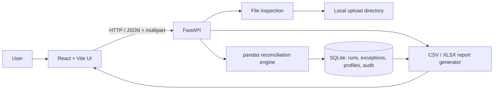

# Implementation Notes

## Product decisions

1. **Local-first monolith.** FastAPI owns file ingestion, pandas processing, SQLite persistence, and report generation. React is a separate development frontend, while both processes run on the same machine.
2. **Deterministic exact matching first.** Matching is performed only when a key is present and unique on each side. Duplicate key groups are not auto-paired because doing so can create ambiguous or many-to-many comparisons.
3. **Advisory fuzzy matching.** A suggestion includes a confidence score and row references but leaves exact match/unmatched classifications unchanged.
4. **Cell-level quality signals.** Missing values are reported per cell; duplicate key/row conditions are reported per affected data row; value differences are reported per selected field pair.
5. **SQLite exception register.** Run summary/configuration is saved in one record; exceptions are stored individually so filtering and pagination do not require a full in-memory JSON result to be loaded by the UI.
6. **Reports prioritize traceability.** XLSX exports contain a Summary sheet and an Exceptions sheet; CSV export is a flat exception list.

## Component architecture

## Failure behavior

- Unsupported extension, empty upload, invalid headers, oversized file, or excessive row count returns an actionable 4xx response.
- Missing or stale upload IDs stop the run before processing.
- Key/compare field names are revalidated server-side even when they originated in the UI.
- Duplicate keys do not stop the entire run; they are logged as exceptions while the affected groups are kept out of exact pairing.
- The fuzzy feature is gated to one key and up to 5,000 unmatched rows per side. When the gate is exceeded, the exact reconciliation succeeds and a warning explains why suggestions were skipped.
- Exception detail retention is capped to 200,000 per run. The count of omitted details is included in the response so truncated exports are not presented as exhaustive.
- Report downloads are generated from stored exception records; a run remains viewable after deleting the original uploaded copy from the workbench.

## MVP non-goals

- Authentication, role-based authorization, multi-user workspaces, and network deployment.
- Direct integration with banking systems, SFTP, or scheduled external report downloads.
- Editing/repairing source values or automatically choosing a winning value.
- Automatic acceptance of fuzzy candidates.
- Reconciliation across more than two datasets in a single run.
- Legacy `.xls` files and files over the documented size/row limits.
- Fine-grained job cancellation/progress streaming for long runs.

## Production hardening backlog

- Add authentication and user-scoped data isolation before network exposure.
- Add configurable retention with secure deletion of uploads, reports, exception records, profiles, and audit records.
- Add background jobs, progress reporting, cancellation, and idempotency for large reconciliations.
- Add benchmarks for representative CSV/XLSX files and optimize the engine based on measured memory/time behavior.
- Add CI, dependency lockfiles, software composition analysis, static analysis, coverage gates, and a production server configuration.
- Add keyboard/screen-reader testing and accessibility review on the actual browser targets.
- Review CSV/XLSX export behavior and audit retention against the deployment's security requirements.
